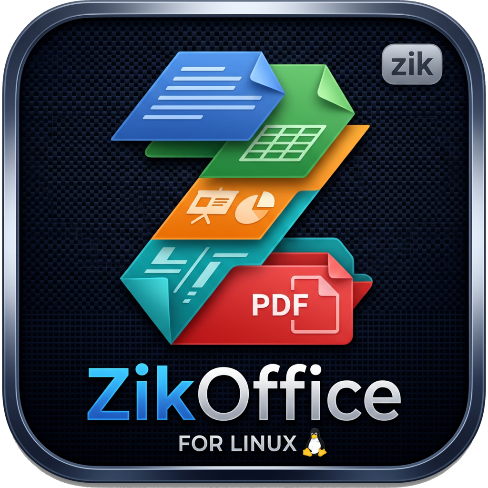

<p align="center">
  
</p>

<h1 align="center">ZikOffice</h1>

<p align="center">
  <b>Una suite per ufficio veloce e privata per Linux.</b><br>
  Documenti, fogli di calcolo, presentazioni e PDF in una sola applicazione leggera che apre i tuoi file <code>.docx</code>, <code>.xlsx</code>, <code>.pptx</code>, <code>.pages</code> e <code>.numbers</code>.
</p>

<p align="center"><a href="README.md">English</a> · <b>Italiano</b></p>

> Questa è la versione italiana in breve. La documentazione completa è in inglese: [README.md](README.md) e la cartella [docs/](docs/).

## Perché

Su Linux la scelta era tra LibreOffice (completo ma pesante) e il browser. ZikOffice punta a una via di mezzo:
**un'applicazione piccola, rapida e moderna che apre i file che ti mandano davvero** — Word, Excel, PowerPoint, PDF e
perfino Pages e Numbers di Apple — e ti permette di crearli e modificarli senza installare quattro programmi diversi.

- **Veloce**: finestra nativa (Tauri + WebKitGTK di sistema), niente Java né server. Il pacchetto `.deb` pesa circa 8 MB.
- **Privata**: tutto resta sul tuo computer. L'applicazione non fa richieste di rete e non ha telemetria.
- **Familiare**: ribbon come quello che conosci, ricerca dei comandi (`Alt+Q`), tema chiaro e scuro, sei lingue.
- **Semplice dove serve**: nelle presentazioni è il *tema* a decidere dove vanno titolo e contenuto, e quello che aggiungi si dispone da solo nello spazio libero.
- **Onesta**: dice cosa non sa ancora fare (vedi *Stato*).

## Cosa c'è

- **Documenti**: pagine vere, stili, elenchi, tabelle, sommario, intestazioni e piè di pagina, note, commenti, immagini, trova e sostituisci, correttore ortografico, stampa unione, cronologia delle versioni; Markdown come formato di prima classe.
- **Fogli di calcolo**: motore [IronCalc](https://www.ironcalc.com); formule **nella tua lingua** (`SOMMA`, `SUM`, `SUMA`…), formattazione, formattazione condizionale, grafici, tabelle pivot, filtri, riquadri bloccati, convalida dati.
- **Presentazioni**: temi con posizioni fisse per titolo e contenuto, disposizione automatica, tabelle, forme, immagini, note del relatore, presentazione a schermo intero, esportazione PDF; apre e salva `.pptx`.
- **PDF**: seleziona, sposta, ridimensiona ed elimina testo, immagini e grafica; ruota, elimina e riordina le pagine; unisci ed estrai; OCR (Tesseract); PDF con password.
- **Extra**: terminale integrato, pannello *Assistente* che usa i programmi `claude` / `agy` già installati, recupero dopo un arresto anomalo.

## Formati

| Tipo | Apre | Salva |
|---|---|---|
| Documenti | `.docx` `.odt` `.rtf` `.html` `.md` `.txt` · `.pages` · `.doc` ¹ | `.docx` `.odt` `.md` `.txt` |
| Fogli | `.xlsx` `.xlsm` ² `.xls` `.xlsb` `.ods` `.csv` `.tsv` · `.numbers` | `.xlsx` `.ods` `.csv` |
| Presentazioni | `.pptx` `.ppsx` `.potx` `.pptm` ² · `.ppt` `.odp` ¹ | `.pptx` |
| PDF | `.pdf` | `.pdf` |

¹ serve LibreOffice per la conversione. ² le macro **non** vengono mai eseguite. I formati Apple non si possono salvare: «Salva» propone `.docx` / `.xlsx`.
Dettagli e perdite note: [docs/formats.md](docs/formats.md).

## Installazione

**Qualsiasi distribuzione (AppImage)** — il modo più rapido per provarlo, senza installare niente: scarica l'AppImage da qui:
[ZikOffice-x86_64.AppImage](https://github.com/encota/zikoffice/releases/latest/download/ZikOffice-x86_64.AppImage) (il link punta sempre all'ultima versione), poi:

```bash
chmod +x ZikOffice-x86_64.AppImage
./ZikOffice-x86_64.AppImage relazione.docx
```

È costruita su Ubuntu 22.04: gira su distribuzioni a 64 bit recenti almeno quanto quella. **Si avvia** su Debian 12, Ubuntu 24.04 e Fedora 45 (verificato in container con uno schermo virtuale; non l'ho provata a fondo su ciascuna). Come ogni AppImage usa le librerie di base del desktop (GTK 3, Mesa, fontconfig), presenti su qualunque distribuzione con interfaccia grafica; su sistemi minimali: `sudo apt install libgtk-3-0 libegl1 libgles2 libgbm1 libfontconfig1`. Se si lamenta di FUSE: `sudo apt install libfuse2` oppure avviala con `--appimage-extract-and-run`. L'AppImage contiene il motore web ma **non** gli strumenti esterni: per i PDF servono `poppler-utils` (necessario), `mupdf-tools` e, per l'OCR, `tesseract-ocr` con la lingua.

**Debian / Ubuntu (`.deb`)**:

```bash
# prima scaricalo da: https://github.com/encota/zikoffice/releases/latest/download/ZikOffice-amd64.deb
sudo apt install ./ZikOffice-amd64.deb
```

- Comando **`zik`**: `zik relazione.docx`, oppure più file insieme: `zik bilancio.xlsx diapositive.pptx`.
- Voce nel menu delle applicazioni.
- ZikOffice diventa l'**applicazione predefinita** per i formati che apre (doppio clic nel gestore file). Succede una volta, per l'utente che installa; se poi scegli un'altra applicazione per un formato, la tua scelta resta. Per rifarlo a mano: `zik --register-file-types`.

**Fedora / openSUSE (`.rpm`)**: [ZikOffice-x86_64.rpm](https://github.com/encota/zikoffice/releases/latest/download/ZikOffice-x86_64.rpm), creato a ogni versione, senza garanzie (non provato). Tutte le versioni e l'ultima build di sviluppo (*nightly*): pagina [Releases](https://github.com/encota/zikoffice/releases).

Compilazione dai sorgenti: [docs/building.md](docs/building.md).

## Privacy

ZikOffice **non ti traccia**: niente telemetria, statistiche, account né controlli di aggiornamento, e nell'applicazione non c'è codice di rete. I tuoi documenti restano sul tuo computer.

**Una cosa da sapere.** Se usi il pannello *Assistente*, oppure avvii nel *Terminale* integrato programmi come `claude` o `agy`, il testo che dai loro viene inviato **da quei programmi** ai **loro** servizi, fuori dal tuo computer. Come viene conservato e usato lo decidono quei servizi, non ZikOffice, e non ne siamo responsabili. ZikOffice mostra un avviso in quei pannelli (si può chiudere, o nascondere fino al prossimo aggiornamento). Senza quei programmi installati non può uscire nulla. Dettagli: [docs/privacy.md](docs/privacy.md).

## Stato

ZikOffice è in **alfa iniziale (v0.1)**. È già utilizzabile, ma ci sono asperità:

- Sviluppato e provato **solo su Linux**.
- La compatibilità è stata controllata aprendo, salvando e riaprendo file reali e confrontando i risultati (LibreOffice, `poppler`), **non** con Microsoft Office, Apple iWork o Adobe. I documenti complessi a volte appaiono diversi: le segnalazioni con il file allegato sono il contributo più prezioso.
- Non ancora: animazioni nelle presentazioni, collaborazione in tempo reale, macro, modifica del *testo* di un PDF, Keynote; grafici e formattazione condizionale non si vedono in Excel/LibreOffice dopo il salvataggio (ZikOffice li tiene in una parte propria del file).
- Le traduzioni sono state scritte dal manutentore con un assistente AI e **non sono state riviste da madrelingua**.
- Gran parte del codice è stata scritta con un assistente AI ([Claude Code](https://claude.com/claude-code)); il progetto ha test automatici ed è verificato su file reali, ma **tieni una copia dei documenti importanti**.

## Contribuire

Segnalazioni con un file di esempio, traduzioni, documentazione e codice sono benvenuti: [CONTRIBUTING.md](CONTRIBUTING.md) (in inglese; puoi scrivere in italiano nelle issue). Sicurezza: [SECURITY.md](SECURITY.md).

## Contatti

- Errori e problemi con un file: [apri una issue](https://github.com/encota/zikoffice/issues/new/choose) (allega il file se puoi; puoi scrivere in italiano).
- Domande e idee: [Discussions](https://github.com/encota/zikoffice/discussions).
- Qualcosa di riservato (problemi di sicurezza, segnalazioni di comportamento): il modulo **Security → Report a vulnerability** del repository; lo legge solo il manutentore. Vedi [SECURITY.md](SECURITY.md).

## Licenza

Doppia licenza, a tua scelta: [Apache-2.0](LICENSE-APACHE) oppure [MIT](LICENSE-MIT). Componenti di terzi: [THIRD_PARTY_LICENSES.md](THIRD_PARTY_LICENSES.md).
Il nome e il logo ZikOffice non fanno parte della licenza del codice: vedi [brand/README.md](brand/README.md).
