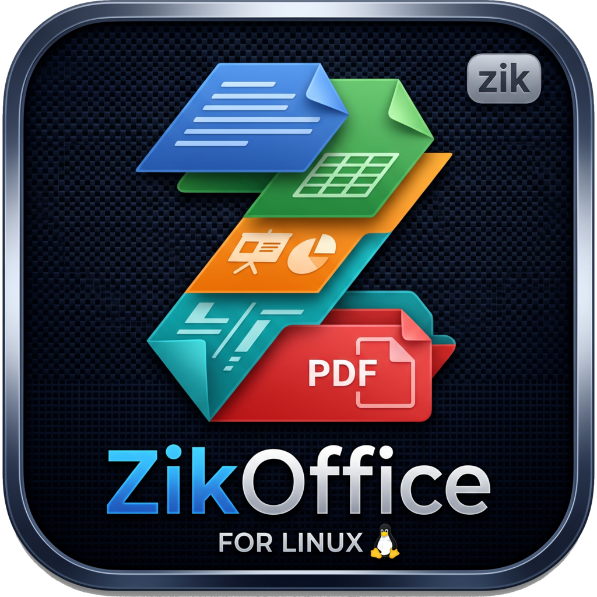
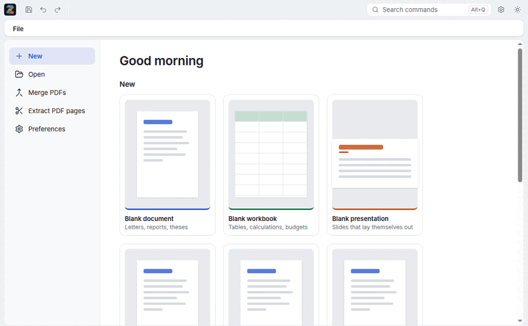
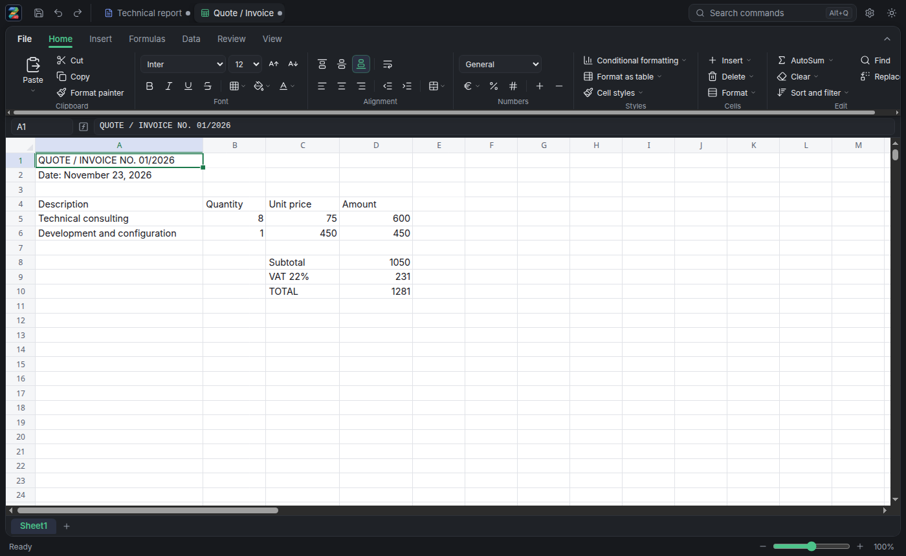
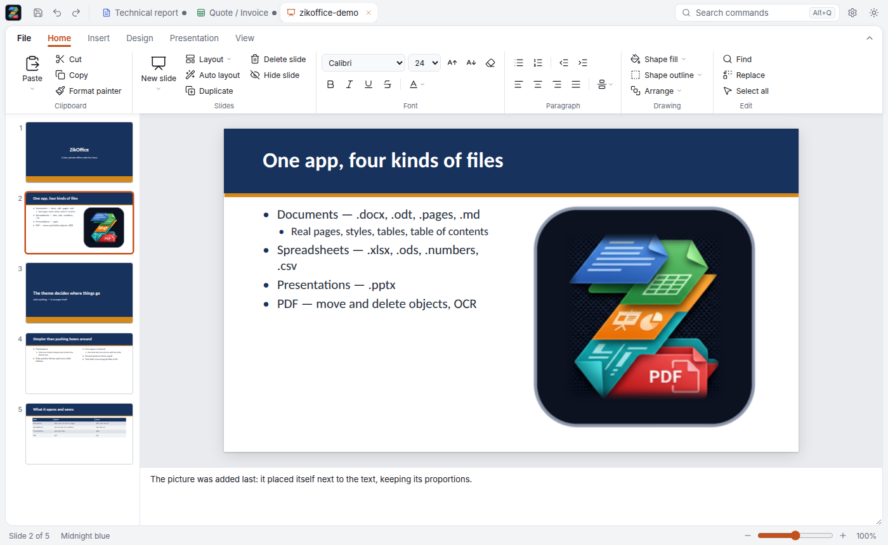
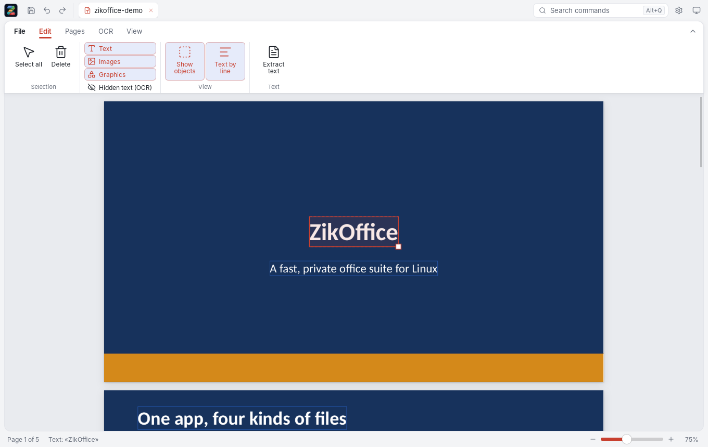
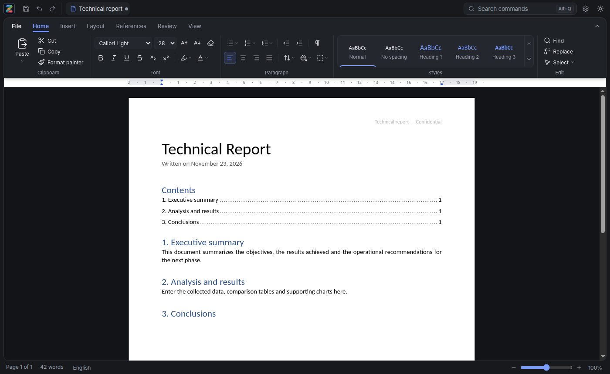
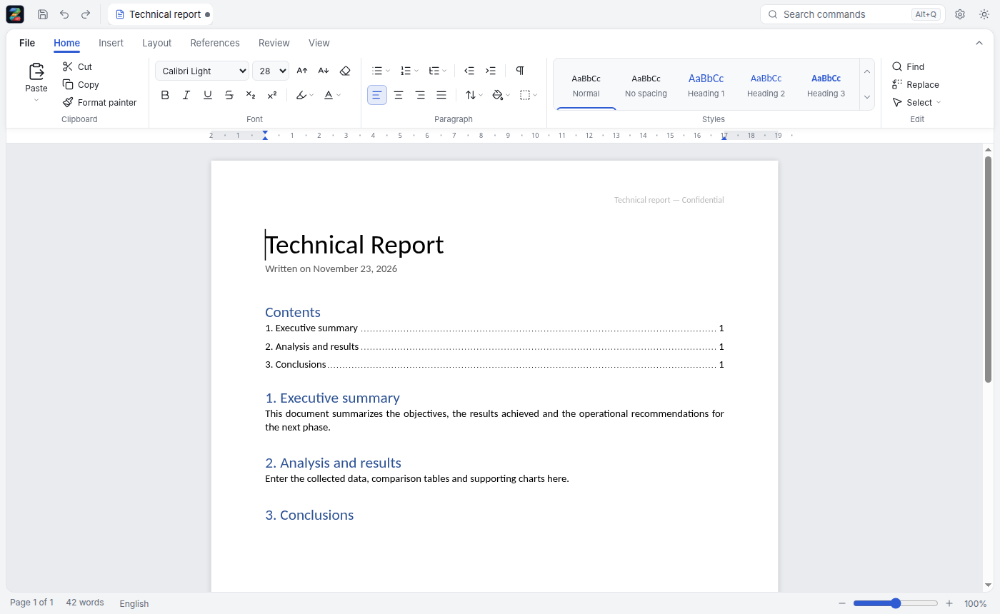
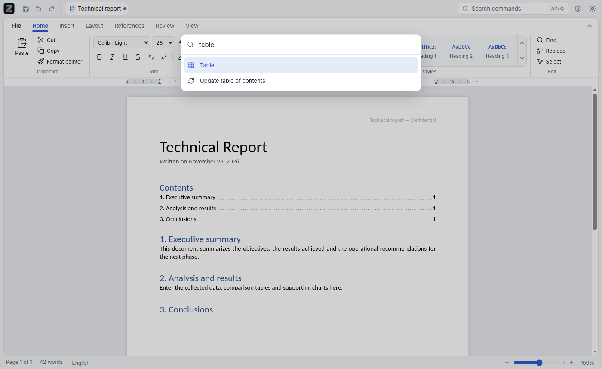
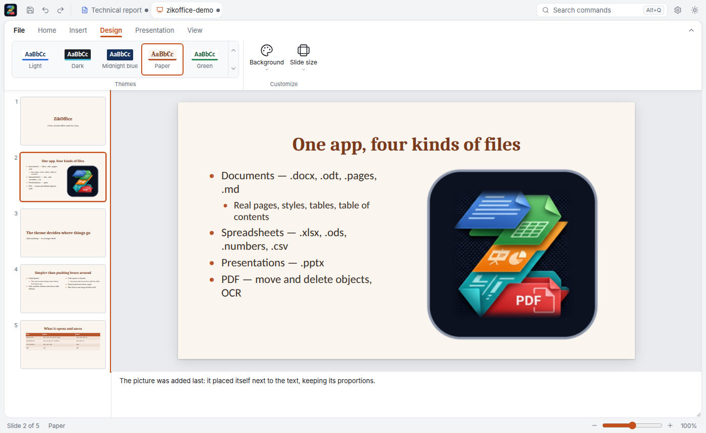
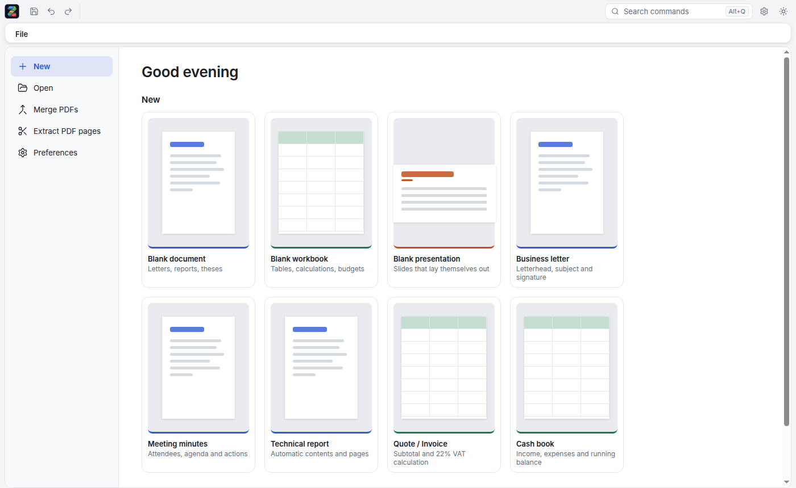

<p align="center">
  
</p>

<h1 align="center">ZikOffice</h1>

<p align="center">
  <b>A fast, private office suite for Linux.</b><br>
  Documents, spreadsheets, presentations and PDF — in one small app that opens your <code>.docx</code>, <code>.xlsx</code>, <code>.pptx</code>, <code>.pages</code> and <code>.numbers</code> files.
</p>

<p align="center">
  <a href="https://github.com/encota/zikoffice/actions/workflows/ci.yml"></a>
  
  <a href="https://github.com/encota/zikoffice/releases/latest"></a>
  
  
  <a href="https://alternativeto.net/software/zikoffice/"></a>
</p>

<p align="center">
  <a href="#install">Install</a> ·
  <a href="#what-it-does">Features</a> ·
  <a href="#supported-formats">Formats</a> ·
  <a href="#build-from-source">Build</a> ·
  <a href="CONTRIBUTING.md">Contribute</a> ·
  <a href="README.it.md">Italiano</a>
</p>

<p align="center">
  
</p>

## Why ZikOffice?

On Linux the choice has been LibreOffice (complete, but heavy) or a browser. ZikOffice aims at something
in between: **a small, quick, modern app that opens the files people actually send you** — Word, Excel,
PowerPoint, PDF, and even Apple's Pages and Numbers — and lets you create and edit them without
installing four different programs.

- **Quick.** A native window (Tauri + the system WebKitGTK), no Java, no server. The whole `.deb` is about 8 MB.
- **Private.** Everything is local: no telemetry, no accounts, no update checks — the application contains no network code at all ([Privacy](docs/privacy.md)).
- **Familiar.** A ribbon like the one you know, a command palette (`Alt+Q`), light and dark themes, six interface languages.
- **Simple where it counts.** In presentations the *theme* decides where the title and content go, and whatever you add arranges itself in the free space — no pushing boxes around.
- **Honest.** It says what it cannot do yet (see [Status](#status)).

## What it does

| | |
|---|---|
| **Documents** | Real pages, styles, lists, tables, table of contents, headers/footers, footnotes, comments, images, find & replace, spell checking (Hunspell), mail merge, version history. Markdown is a first-class format: edit it as a document or as source. |
| **Spreadsheets** | Canvas grid on the [IronCalc](https://www.ironcalc.com) engine. Formulas in **your language** (`SUM`, `SOMMA`, `SUMA`, `SOMME`, `SUMME`), formatting, conditional formats, charts, pivot tables, filters, freeze panes, data validation, named ranges. *(Charts, conditional formats, notes and validation are saved in a ZikOffice-only extension of the `.xlsx`: other programs do not show them yet — see [formats](docs/formats.md).)* |
| **Presentations** | Themes with fixed positions for title and content, automatic layout of what you add, tables, shapes, images, speaker notes, full-screen slide show, PDF export. Opens and saves `.pptx`, keeping charts and SmartArt it cannot edit. |
| **PDF** | Select, move, resize and delete text, images and graphics. Rotate, delete and reorder pages, merge and split, OCR scans (Tesseract), open password-protected files. |
| **Extras** | Integrated terminal; optional *Assistant* panel that drives the `claude` / `agy` command-line tools you already have; crash recovery; per-file version history. |

<p align="center">
  
  
</p>

<p align="center">
  
  
</p>

<details>
<summary>More screenshots</summary>

<p align="center">
  
  
  
  
</p>

</details>

## Supported formats

| Kind | Open | Save |
|---|---|---|
| Documents | `.docx` `.odt` `.rtf` `.html` `.md` `.txt` · `.pages` (Apple) · `.doc` ¹ | `.docx` `.odt` `.md` `.txt` |
| Spreadsheets | `.xlsx` `.xlsm` ² `.xls` `.xlsb` `.ods` `.csv` `.tsv` · `.numbers` (Apple) | `.xlsx` `.ods` `.csv` |
| Presentations | `.pptx` `.ppsx` `.potx` `.pptm` ² · `.ppt` `.odp` ¹ | `.pptx` |
| PDF | `.pdf` (edit objects and pages, OCR) | `.pdf` |

¹ needs LibreOffice installed (`soffice`) for the conversion. ² macros are **never** executed.

Apple formats cannot be *saved* — nobody can write them reliably — so *Save* offers `.docx` / `.xlsx`, which
Pages and Numbers open. Details and known losses: [docs/formats.md](docs/formats.md).

## Install

### Download

| Package | Latest release | For |
|---|---|---|
| **AppImage** | [ZikOffice-x86_64.AppImage](https://github.com/encota/zikoffice/releases/latest/download/ZikOffice-x86_64.AppImage) | any 64-bit Linux |
| **.deb** | [ZikOffice-amd64.deb](https://github.com/encota/zikoffice/releases/latest/download/ZikOffice-amd64.deb) | Debian, Ubuntu, Mint… |
| **.rpm** | [ZikOffice-x86_64.rpm](https://github.com/encota/zikoffice/releases/latest/download/ZikOffice-x86_64.rpm) | Fedora, openSUSE… (untested) |
| Checksums | [SHA256SUMS.txt](https://github.com/encota/zikoffice/releases/latest/download/SHA256SUMS.txt) | |

These links always point to the newest release; the version number is in the badge above and on the
[Releases](https://github.com/encota/zikoffice/releases) page, with older versions and the changelog.
The latest development build is on the [nightly](https://github.com/encota/zikoffice/releases/tag/nightly) pre-release, rebuilt every day at 20:00 (Italian time) when something changed (may be unstable).
Everything is built automatically by GitHub from the source in this repository.

### Any Linux distribution (AppImage)

The quickest way to try ZikOffice, with nothing to install: download the AppImage above, then

```bash
chmod +x ZikOffice-x86_64.AppImage
./ZikOffice-x86_64.AppImage report.docx
```

It is built on Ubuntu 22.04 so that it runs on 64-bit distributions at least as recent as that. It **starts** on Debian 12,
Ubuntu 24.04 and Fedora 45 (checked in containers with a virtual display; I have not used it fully on each).
Like every AppImage it relies on the basic desktop libraries of your system — GTK 3, Mesa (OpenGL ES / EGL) and fontconfig —
which any desktop distribution already has. On a minimal system install them first
(Debian/Ubuntu: `sudo apt install libgtk-3-0 libegl1 libgles2 libgbm1 libfontconfig1`; Fedora: `sudo dnf install gtk3`).
If it complains about FUSE, install `libfuse2` (Ubuntu: `sudo apt install libfuse2`) or run it with
`--appimage-extract-and-run`. The AppImage bundles the web engine but **not** the external tools: for PDF features install
`poppler-utils` (needed), `mupdf-tools` and, for OCR, `tesseract-ocr` with a language pack; spell checking needs the
Hunspell dictionary of your language. Everything else works without them.
An AppImage does not register itself as the default application; use a tool like AppImageLauncher, or the `.deb`/`.rpm` below.

### Debian / Ubuntu (`.deb`)

Download the `.deb` above, then:

```bash
sudo apt install ./ZikOffice-amd64.deb
```

That gives you:

- the **`zik`** command — `zik report.docx`, or several files at once: `zik budget.xlsx slides.pptx`;
- an entry in your applications menu;
- ZikOffice as the **default application** for the formats it opens (double-click in your file manager).
  This is done once, for the user who installs; if you later choose another app for a format, that choice is kept.
  To redo it by hand: `zik --register-file-types`.

The `.deb` installs `poppler-utils` and *recommends* the rest, which `apt` installs by default:
Hunspell dictionaries for spell checking, `fonts-crosextra-carlito` and `fonts-crosextra-caladea`
(metric-compatible Calibri and Cambria, so Word and Excel files keep their layout), `mupdf-tools` (PDF rendering),
and `tesseract-ocr` with language packs (OCR). LibreOffice is **optional**, used only to open `.doc`, `.ppt` and `.odp`.

### Fedora / openSUSE (`.rpm`)

An `.rpm` is built with every release on a best-effort basis (not tested yet): `sudo dnf install ./ZikOffice-x86_64.rpm`.
Windows and macOS builds are not published.

### Build from source

See [docs/building.md](docs/building.md). In short:

```bash
git clone https://github.com/encota/zikoffice && cd zikoffice/app
npm install
npm run tauri dev        # run with live reload
npm run tauri build      # build the .deb
```

## Privacy

ZikOffice **does not track you**: no telemetry, no analytics, no accounts, no update checks, and no network code in the
application (its interface is also blocked from connecting anywhere). Your documents stay on your computer.

**One thing to know.** If you use the *Assistant* panel, or run tools such as `claude` or `agy` in the integrated *Terminal*,
the text you give them is sent by *those tools* to *their* services, outside your computer. How it is stored and used is
decided by those services, not by ZikOffice, and we are not responsible for it. ZikOffice shows a notice about this in those panels
(dismissible; you can hide it until the next update). Without those tools installed, nothing can leave.
Details, what is stored locally, and how to verify all this: **[docs/privacy.md](docs/privacy.md)**.

## Status

ZikOffice is **early alpha (v0.1)**. It is already useful, but be prepared for rough edges:

- Developed and tested on **Linux only**. The code is cross-platform (Tauri 2), the surrounding tools are not packaged elsewhere yet.
- Compatibility was checked by round-tripping real-world files and comparing renderings (LibreOffice, `poppler`),
  **not** with Microsoft Office, Apple iWork or Adobe software. Complex documents will sometimes look different.
  Reports with the offending file are the most valuable contribution you can make — see [CONTRIBUTING.md](CONTRIBUTING.md).
- Not supported yet: charts and conditional formats visible in Excel/LibreOffice after saving (ZikOffice keeps them in its own part of the file), animations in presentations (lost when saving), real-time collaboration, macros, editing the *text* of a PDF (objects can be moved, not retyped), Keynote files.
- Translations were written by the maintainer with an AI assistant and **have not been reviewed by native speakers**. Corrections are very welcome.
- The Portuguese interface uses English function names in formulas (the calculation engine does not have Portuguese ones yet).

Much of the code was written with an AI coding assistant ([Claude Code](https://claude.com/claude-code)); the
project is covered by automated tests and checked against real files, but treat it as you would any young software
and **keep backups of important documents**.

### Roadmap

- Test the AppImage and `.rpm` on more distributions; Flatpak.
- Keynote import, presentation animations and transitions editor, image cropping and shadows.
- Windows and macOS builds.
- Review of every translation by native speakers; more languages.
- Plugins / scripting (not designed yet).

## Documentation

[Supported formats and known losses](docs/formats.md) · [Presentations](docs/presentations.md) · [PDF and OCR](docs/pdf.md) ·
[Markdown](docs/markdown.md) · [Apple Pages and Numbers](docs/apple-files.md) · [Terminal and Assistant](docs/assistant.md) · [Privacy](docs/privacy.md) ·
[Translations](docs/i18n.md) · [Architecture](docs/architecture.md) · [Building](docs/building.md).
Try it with the example deck: [`examples/zikoffice-demo.pptx`](examples/zikoffice-demo.pptx).

## Contributing

Bug reports with a sample file, translations, documentation and code are all welcome.
Start with [CONTRIBUTING.md](CONTRIBUTING.md); everyone taking part agrees to the [Code of Conduct](CODE_OF_CONDUCT.md).
Security issues: [SECURITY.md](SECURITY.md).

## Contact

- Bugs and file problems: [open an issue](https://github.com/encota/zikoffice/issues/new/choose) (attach the file if you can).
- Questions and ideas: [Discussions](https://github.com/encota/zikoffice/discussions).
- Anything private (security problems, conduct reports): the repository's **Security → Report a vulnerability** form;
  only the maintainer can read it. See [SECURITY.md](SECURITY.md).

## License

Licensed under either of

- Apache License, Version 2.0 ([LICENSE-APACHE](LICENSE-APACHE))
- MIT license ([LICENSE-MIT](LICENSE-MIT))

at your option. Unless you explicitly state otherwise, any contribution intentionally submitted for inclusion
in ZikOffice shall be dual licensed as above, without any additional terms or conditions.
Third-party components and their licenses: [THIRD_PARTY_LICENSES.md](THIRD_PARTY_LICENSES.md).

## Acknowledgements

ZikOffice stands on excellent open-source work: [Tauri](https://tauri.app), [IronCalc](https://www.ironcalc.com)
(spreadsheet engine), [lopdf](https://github.com/J-F-Liu/lopdf), [calamine](https://github.com/tafia/calamine),
[marked](https://marked.js.org), [xterm.js](https://xtermjs.org), [fflate](https://github.com/101arrowz/fflate),
[Lucide](https://lucide.dev) icons, [spellbook](https://github.com/helix-editor/spellbook) with Hunspell dictionaries,
[Tesseract](https://github.com/tesseract-ocr/tesseract), [MuPDF](https://mupdf.com) and [poppler](https://poppler.freedesktop.org) (used as external tools),
and LibreOffice for the optional conversion of legacy formats.
"Microsoft", "Word", "Excel", "PowerPoint", "Apple", "Pages", "Numbers", "Keynote" and "Adobe" are trademarks of their
respective owners; ZikOffice is not affiliated with them and only reads and writes their public or reverse-engineered file formats.
